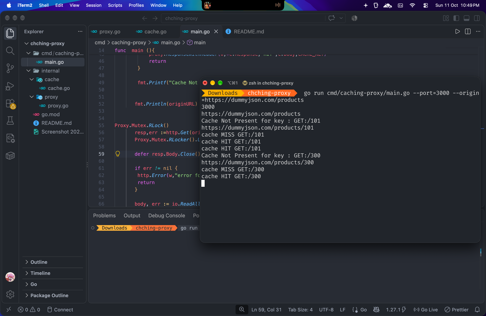

 

# Caching Proxy

a small HTTP caching proxy written in Go. It accepts requests
from a client, forwards cache misses to a configured origin server, stores the
origin response in memory, and serves the stored response for subsequent
requests.


The project is based on the [Caching Server project](https://roadmap.sh/projects/caching-server)
from roadmap.sh.

## How it works

1. The proxy starts an HTTP server on the configured port.
2. For each request, it creates a cache key from the request method and URL.
3. If the key is already in the in-memory cache:
   - The cached response body is returned.
   - The response includes `X-Cache: HIT`.
4. If the key is not cached:
   - The request is forwarded to the configured origin.
   - The response body and status are stored in memory.
   - The response includes `X-Cache: MISS`.


The cache is process-local and is lost when the proxy stops or restarts. There
is currently no expiration policy, disk persistence, or cache-size limit.

## Requirements

- Go 1.27.1 or a compatible newer Go release
- Network access to the origin server

## Run the proxy

From the project root:

```bash
go run ./cmd/caching-proxy -origin https://example.com -port 8080
```

The proxy will listen at `http://localhost:8080`.

You can also build and run a binary:

```bash
go build -o caching-proxy ./cmd/caching-proxy
./caching-proxy -origin https://example.com -port 8080
```

## Command-line options

| Option | Default | Description |
| --- | --- | --- |
| `-origin` | empty | Base URL of the server to which cache misses are forwarded. Required. |
| `-port` | `8080` | Port on which the proxy listens. |
| `-clear_cache` | `false` | Initializes the proxy with an empty cache. |

For example:

```bash
go run ./cmd/caching-proxy \
  -origin https://jsonplaceholder.typicode.com \
  -port 8080 \
  -clear_cache=true
```

## Test it with curl

Request a resource through the proxy:

```bash
curl -i http://localhost:8080/todos/1
```

The first request should contain:

```text
X-Cache: MISS
```

Repeat the same request:

```bash
curl -i http://localhost:8080/todos/1
```

The cached response should contain:

```text
X-Cache: HIT
```

Different request methods or URLs produce different cache keys. The current
server forwards requests using `http.Get`, so cache misses are forwarded as
HTTP GET requests.

## Project structure

```text
.
├── cmd/
│   └── caching-proxy/
│       └── main.go          # CLI flags, HTTP server, and request handling
├── internal/
│   ├── cache/
│   │   └── cache.go         # In-memory cache entry type
│   └── proxy/
│       └── proxy.go         # Cache management and response helpers
└── go.mod                   # Go module metadata
```

## Limitations

- Cached data is stored only in memory.
- There is no TTL or maximum cache size.
- The proxy currently handles cache misses as GET requests to the origin.
- Cache entries are not persisted between runs.
- The origin URL should be supplied as a base URL, such as
  `https://example.com` or `https://example.com/api`.

## Roadmap project

Project specification: [Build a Caching Server](https://roadmap.sh/projects/caching-server)
